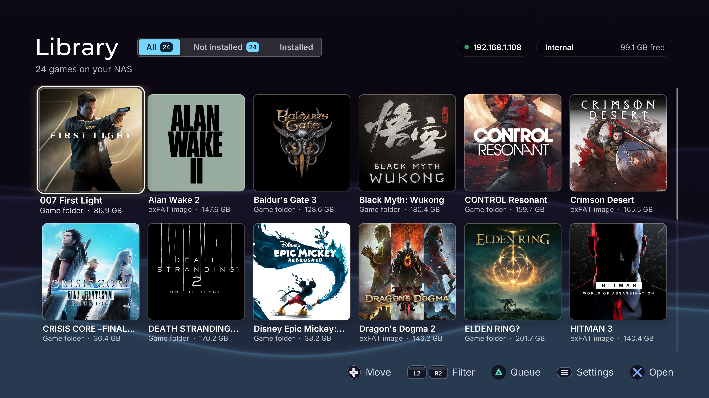
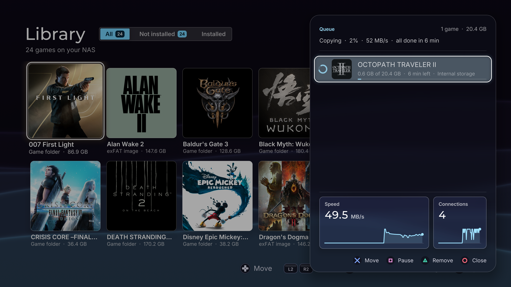
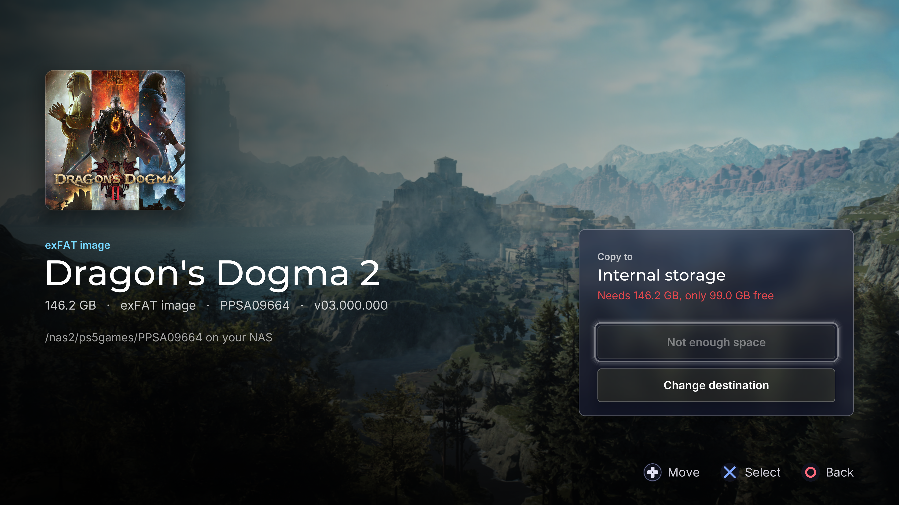
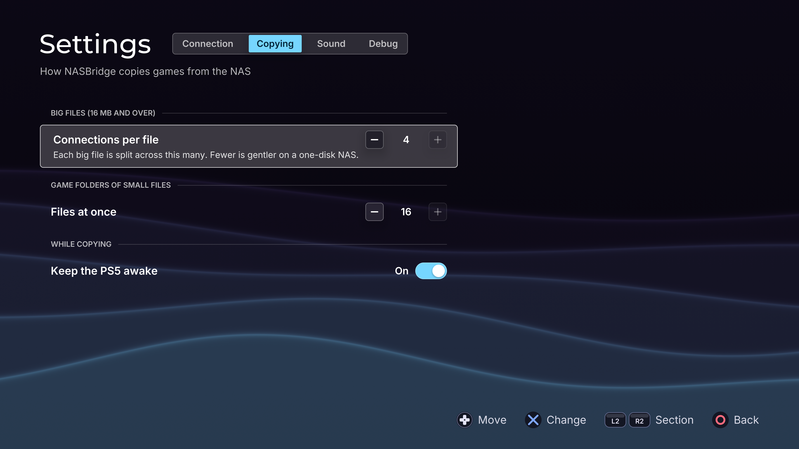

# NASBridge for PS5

A native PS5 homebrew app to browse and install games from your NAS.









## What it does

- **Browses your NAS over WebDAV, SMB or FTP**. Your games show up as a library with 
  their names, covers and
  sizes, read from each game's `sce_sys` folder. Game folders are found up to
  four folders down, and `.exfat` images are read without downloading them.
- **Copies games to the PS5.** Queue as many as you like. The queue can be
  reordered, paused and resumed, and it picks up where it left off if
  NASBridge or the PS5 restarts. Free space is checked before each game.
- **Also supports external drives plugged into the PS5 as a destination.**
  Games go in the drive's `homebrew` folder, where ShadowMountPlus finds them.
  Games on a drive show as installed while it's plugged in and disappear when
  it's unplugged. If the drive is unplugged mid-copy, the queue pauses and
  carries on by itself when it's plugged back in.
- **Copies quickly.** Big files are fetched over several connections at once.
  Folders of thousands of small files go through a helper payload that
  fetches many at a time.
- **Adds copied games to the home screen.** It asks ShadowMountPlus to pick
  each game up as soon as it's copied.
- **Deletes games from the PS5.** The game is removed from the home screen and
  its files deleted, with progress shown. The copy on your NAS isn't touched.
- **Keeps the PS5 awake** while a copy or a delete runs (optional).
- **Settings:** NAS connection (with a folder browser and a connection test),
  connections per big file, small files at once, sounds, and debug info.

## Requirements

- A jailbroken PS5 with an **ELF loader on port 9021** (etaHEN, elfldr or
  similar). NASBridge uses it while it runs, to start its copy and delete
  helpers.
- ShadowMountPlus which puts games in `/data/homebrew` on the home screen.
  - For the full experience (copied games appear while NASBridge is open, and
    games can be deleted while it's open), use version 1.7beta6-fix2 or newer.
  - With older versions, copied games appear only once you close NASBridge, and
    a game you've just copied can only be deleted after restarting the PS5.
- A NAS (or any computer) sharing your games over **WebDAV**, **SMB** or **FTP**.
  - WebDAV: on a Synology, that's the WebDAV Server package (port 5005). On
    Unraid, that's likely a WebDAV docker container.
  - SMB is built into most NAS systems: turn it on, and give a user read 
    access to the games share. In NASBridge, enter the NAS's IP address, 
    that username and password, then pick your games folder with the folder 
    button; its first part is the share (`/Games/PS5`). SMB 2 or newer is needed.
  - Sign in with a username and password: guest access doesn't work. On
    Unraid, a share set to Public (guest) is refused. Set the games share to
    Private, add a user for NASBridge under Users, and give it Read-only
    access to the share.
  - FTP is built into most NAS systems too: turn it on (plain FTP with
    passive mode; FTPS and SFTP aren't supported), and give a user read
    access to the games folder. In NASBridge, enter the NAS's IP address,
    that username and password (leave both empty to sign in as anonymous),
    then pick your games folder with the folder button. NASBridge opens
    several connections at once to copy quickly; if the NAS limits
    connections per user or per address, it carries on with the ones it gets.
- Only to build it yourself: a Mac or Linux machine with Docker (Docker
  Desktop or OrbStack) and `make`.

Tested on a PS5 on firmware 13.60.

## Install

1. Make sure you have ShadowMountPlus 1.7beta6-fix2 or newer, from its
   [releases](https://github.com/drakmor/ShadowMountPlus/releases).
2. Download `NASBridge-<version>.elf` from the
   [latest release](https://github.com/J7mbo/nasbridge-ps5/releases/latest).
3. Send it to the ELF loader the same way, with any payload sender, such as
   [ps5upload](https://github.com/phantomptr/ps5upload). From a Mac or Linux
   terminal, this works too:
   ```sh
   nc -w 5 192.168.1.123 9021 < NASBridge-0.5.0.elf   # your PS5's IP address
   ```
4. A notification says when it's installed. NASBridge then appears on the home
   screen within a few seconds.

**To update**, close NASBridge, then send the new version's ELF the same way.
It replaces the app and refreshes the home screen's icon, backgrounds and
music, and your settings are kept. It refuses while NASBridge is open.

**To remove it**, delete the `/data/homebrew/LAPY62737` folder (for example
over FTP), then delete NASBridge's tile from the home screen. Do it in that
order: ShadowMountPlus adds back any tile whose folder is still there.

### Upgrading from 0.3.0

NASBridge 0.4.0 and later has a new title ID (`LAPY62737`), so it installs as
a new app instead of replacing 0.3.0, and it needs ShadowMountPlus
1.7beta6-fix2 or newer.

1. Update ShadowMountPlus to 1.7beta6-fix2 or newer, from its
   [releases](https://github.com/drakmor/ShadowMountPlus/releases).
2. Remove NASBridge 0.3.0: delete the `/data/homebrew/PPSA62737` folder (using for example PS5Upload), 
   then delete the old NASBridge tile from the home screen.
3. Install the latest version as above, then set up your NAS connection again
   (settings are kept per title ID, so it starts fresh).

### Installing from source

```sh
make install PS5_HOST=192.168.1.123
```

This builds NASBridge and installs it straight to the PS5. The first build
sets up the toolchain container, which takes a while. Run it again to update,
and use `make uninstall PS5_HOST=192.168.1.123` to fully remove it.

## Using it

1. Open NASBridge from the home screen.
2. Press **Options** to open Settings, enter your NAS's address, user name
   and password, and choose the folder your games are in. **Test
   connection** checks it all and counts the games it finds.
3. Pick a game and choose **Download to PS5**. The queue panel shows progress,
   speed and time left.
4. When a copy finishes, the game appears on the home screen.

Your NAS's games folder can hold:

| Layout | Example |
| --- | --- |
| A game folder | `Games/Astro Bot/sce_sys/...` |
| A game folder nested inside others (up to 4 levels) | `Games/Astro Bot/dump/PPSA01234-app/sce_sys/...` |
| An `.exfat` image, on its own or in a folder | `Games/Astro Bot.exfat` |

NASBridge only reads from your NAS. It never changes or deletes anything there.

## Good to know

- **Deleting big games takes a while.** The PS5 deletes files at around 200
  per second however it's asked, so a game of 50,000 files takes about four
  minutes. The game leaves the home screen at the start.
- **Copy speed depends on your NAS.** A NAS with a single spinning disk is
  slowest on folders of many small files. If copies make it struggle, lower
  the connection counts in Settings.
- **Patches and backports aren't copied.** For a game folder, NASBridge copies
  the folder holding `sce_sys`, and leaves out patch folders, archives and
  hidden files beside it.
- **Measuring huge game folders takes a while.** A folder game's size is
  added up from every file in it, after the library has appeared. A folder
  of tens of thousands of files can take minutes on its own. Its size shows
  as soon as it's measured, and is kept for next time unless the folder
  changes.

## Building from source

Everything runs inside a Docker container, so Docker and `make` are all you
need.

| Command | What it does |
| --- | --- |
| `make build` | Build everything into `out/` |
| `make install PS5_HOST=<ip>` | Build, then install to the PS5's home screen |
| `make uninstall PS5_HOST=<ip>` | Remove NASBridge from the PS5 |
| `make release` | Build `out/NASBridge-<version>.elf`, the single-file installer |
| `make test` | Run the test suites (on your computer, against a fake WebDAV NAS, a Samba server, an FTP server and a fake PS5) |
| `make snapshots` | Render every screen to `out/snapshots/` |
| `make shell` | Open a shell inside the toolchain container |
| `make clean` | Delete build output |

The build is reproducible. The toolchain image pins the
[PS5 payload SDK](https://github.com/ps5-payload-dev/sdk) and the UI kit at
exact commits, so two builds of the same commit produce the same files.

```
app/      the app: screens, artwork and home-screen metadata (sce_sys)
tools/    the installer, copy helper and delete helper payloads
tests/    test suites, with a fake WebDAV NAS, a real Samba server for SMB,
          a real FTP server (pyftpdlib) for FTP, and a fake PS5 loader
Dockerfile, Makefile, ps5.mk   the toolchain and build
```

## Credits

- UI built with ps5-homebrew-ui by BlackBearReloaded (GPL-3.0-or-later),
  including its OpenGL runtime, fonts and sound effects. The original
  repository is no longer public; its source is kept at
  [J7mbo/ps5-homebrew-ui](https://github.com/J7mbo/ps5-homebrew-ui).
- Selection music: an excerpt of "First Light" from the ps5-homebrew-ui kit,
  Copyright (C) 2026 BlackBearReloaded (GPL-3.0-or-later).
- Built on the [PS5 payload SDK](https://github.com/ps5-payload-dev/sdk).
- SMB support uses [libsmb2](https://github.com/sahlberg/libsmb2) by Ronnie
  Sahlberg (LGPL-2.1-or-later).
- Games are added to the home screen by
  [ShadowMountPlus](https://github.com/drakmor/ShadowMountPlus).

Every third-party component, with its copyright and licence, is listed in
[THIRD_PARTY_NOTICES.md](THIRD_PARTY_NOTICES.md).

## Licence

NASBridge is licensed under the [GPL-3.0-or-later](LICENSE), the same licence
as the ps5-homebrew-ui kit it's built on. Third-party components keep their
own licences; see [THIRD_PARTY_NOTICES.md](THIRD_PARTY_NOTICES.md).

NASBridge is an independent homebrew project, not affiliated with or endorsed
by Sony Interactive Entertainment.
